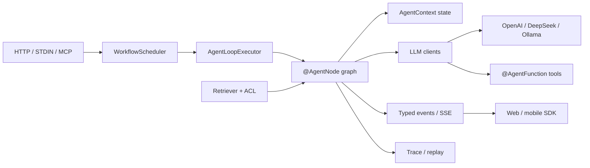

# TianGong（天工）

> Java 21 的 Agent 工作流框架：注解式节点编排 + 轻量 IoC 容器 + 多 Provider LLM 流式工具循环。

[](https://central.sonatype.com/artifact/io.github.berrybus-official/tiangong-core)
[](LICENSE)


TianGong（CraftEngine）是一个面向 Java 21 的轻量 Agent 框架。它把一次对话或任务拆成注解式节点图，
用内置 IoC 容器装配节点、工具与 LLM 客户端；模型在流式响应中请求的工具由框架**在流内自动执行并回放**，
节点只负责业务逻辑，不必手写 `while + call_tool` 循环。

框架不依赖 Spring 运行，也提供可选的 Spring 宿主集成。核心能力包括：

- **注解式工作流**：`START` / `COMMON` / `BRANCH` / `PARALLEL` / `MERGE` / `END` 节点，
  以及 `@ApiEntranceNode` / `@StdinEntranceNode` / `@ApiExportNode` 等入口出口。
- **轻量 IoC**：编译期扫描注解、运行期容器注入，支持单例 / 原型作用域与生命周期。
- **多 Provider LLM**：OpenAI、DeepSeek、Ollama；流式输出、工具循环、结构化输出。
- **调用者上下文与工具治理**：`AgentCallContext`（userId / tenantId / scopes / traceId），
  按 scope 过滤工具，支持审批与审计；失败默认拒绝。
- **护栏与租户策略**：PII 脱敏、提示注入检测、不可信工具输出围栏、输出哨兵清理、工具结果大小上限；
  租户级工具 scope 与限流；HITL 审批队列及 HTTP 管理端点。
- **工具运行时**：超时、重试、按工具熔断、同轮并行工具；客户端断连取消上游流。
- **类型化 Agent 事件**：正文 / 思考 / 工具调用 / 引用 / 产物 / 用量 / 结构化结果，
  带 `seq`、`runId`、`turnId`，支持 SSE 与 `Last-Event-ID` 续传。
- **检索与引用**：`Retriever` SPI、scope + tenant ACL、citation 去重与提示词上下文拼装。
- **路由与成本**：按任务选择候选模型、失败/空回答降级、推理 token 预算、token 成本账本。
- **可观测与恢复**：trace + golden trace 校验、检查点恢复、沙箱、MCP 与目录式技能。

## 架构



一次运行中，`AgentLoopExecutor` 按 `@NodeNext` 推进节点；节点读写 `AgentContext`，通过
`LlmClient` 发起流式请求。模型请求工具时，框架查询 `FunctionRegistry`、执行工具并把结果回放给模型，
直到模型不再请求工具。事件、引用与 trace 是可选的旁路，不改变主执行链。

## 模块

| 模块 | 作用 |
| :--- | :--- |
| `tiangong-annotations` | 注解定义、编译期处理器与扫描器 |
| `tiangong-common` | 公共类型、异常、JSON、沙箱、调用者上下文 |
| `tiangong-core` | 容器、AgentLoop、工作流调度、工具治理、检查点、HTTP 入口 |
| `tiangong-boot` | 单机启动入口 `TianGongApplication` |
| `tiangong-llm` | OpenAI / DeepSeek / Ollama 客户端、流式工具循环、结构化输出 |
| `tiangong-protocol` | 类型化 Agent 事件、SSE 编解码、客户端 SDK |
| `tiangong-retrieval` | `Retriever` SPI、ACL、citation、上下文拼装 |
| `tiangong-guardrail` | PII 脱敏、提示注入检测、不可信内容围栏、租户级护栏链 |
| `tiangong-trace` | prompt hash、脱敏摘要、token/成本、golden trace 校验 |
| `tiangong-mcp` / `tiangong-skill` | MCP 服务器与目录式技能接入 |
| `tiangong-spring` | Spring Boot 宿主桥接 |
| `tiangong-test` / `tiangong-user` | 测试脚手架与示例应用 |
| `tiangong-bom` | 天工模块与第三方依赖版本管理 |

## 快速开始

环境要求：JDK 21、Maven 3.9+。

### 1. 引入依赖

推荐先导入 BOM，再按需引入模块。`tiangong-boot` 会传递引入核心、注解与 LLM 模块：

```xml
<dependencyManagement>
    <dependencies>
        <dependency>
            <groupId>io.github.berrybus-official</groupId>
            <artifactId>tiangong-bom</artifactId>
            <version>0.0.1</version>
            <type>pom</type>
            <scope>import</scope>
        </dependency>
    </dependencies>
</dependencyManagement>

<dependencies>
    <dependency>
        <groupId>io.github.berrybus-official</groupId>
        <artifactId>tiangong-boot</artifactId>
    </dependency>
</dependencies>
```

### 2. 定义上下文与节点

把启动类、上下文和节点放在同一个包下，框架会自动扫描启动类所在包：

```java
package com.example.demo;

import com.taixu.tiangong.annotations.annotation.definition.Lifecycle;
import com.taixu.tiangong.annotations.annotation.framework.Component;
import com.taixu.tiangong.annotations.annotation.framework.Scope;
import com.taixu.tiangong.common.agent.context.AgentContext;

@Component
@Scope(Lifecycle.PROTOTYPE)
public class DemoContext implements AgentContext {

    String message;
    private volatile String workflowId;
    private volatile boolean cancelled;

    @Override
    public String workflowId() {
        return workflowId;
    }

    @Override
    public void bindWorkflow(String workflowId) {
        this.workflowId = workflowId;
    }

    @Override
    public boolean isCancelled() {
        return cancelled;
    }

    @Override
    public void cancel() {
        this.cancelled = true;
    }
}
```

```java
package com.example.demo;

import com.taixu.tiangong.annotations.annotation.framework.Component;
import com.taixu.tiangong.annotations.annotation.framework.agent.loop.AgentNode;
import com.taixu.tiangong.annotations.annotation.framework.agent.loop.NodeNext;
import com.taixu.tiangong.annotations.annotation.framework.agent.loop.NodeType;

@Component
public class DemoAgent {

    @AgentNode(value = "start", type = NodeType.START)
    @NodeNext("hello")
    public DemoContext start(DemoContext context) {
        context.message = "Hello, TianGong";
        return context;
    }

    @AgentNode("hello")
    @NodeNext("end")
    public DemoContext hello(DemoContext context) {
        System.out.println(context.message);
        return context;
    }

    @AgentNode(value = "end", type = NodeType.END)
    public void end(DemoContext context) {
        // 本轮结束
    }
}
```

### 3. 启动

```java
package com.example.demo;

import com.taixu.tiangong.annotations.annotation.framework.TianGongApplicationStarter;
import com.taixu.tiangong.annotations.annotation.framework.enable.EnableAgentLoop;
import com.taixu.tiangong.boot.TianGongApplication;

@TianGongApplicationStarter
@EnableAgentLoop(contextClass = DemoContext.class)
public class DemoApplication {

    public static void main(String[] args) throws Exception {
        TianGongApplication.run(DemoApplication.class, args);
    }
}
```

在 IDE 中运行 `DemoApplication#main`，或使用 `mvn compile exec:java -Dexec.mainClass=com.example.demo.DemoApplication`。
这个最小示例不需要 LLM 配置；接入模型后再在节点中调用 `LlmClient`。

### 4. 接入 LLM 与工具

在 `src/main/resources/agent.yml` 配置模型（不要把真实 key 提交到仓库）：

```yaml
agent:
  models:
    - name: chat
      provider: deepseek
      model: deepseek-chat
      base_url: https://api.deepseek.com
      api_key: replace-with-your-key
      chat_options:
        temperature: 0.7
```

用注解声明工具，框架会自动注册到 `FunctionRegistry`：

```java
package com.example.demo;

import com.taixu.tiangong.annotations.annotation.framework.agent.AgentFunction;
import com.taixu.tiangong.annotations.annotation.framework.agent.AgentTool;

import java.time.LocalDateTime;

@AgentTool
public class TimeTools {

    @AgentFunction(name = "get_time", description = "获取当前时间")
    public String now() {
        return LocalDateTime.now().toString();
    }
}
```

在节点中通过 `LlmClient` + `ChatRequestBuilder` 发起流式请求即可；工具调用由框架在流内执行，
节点只需拼接 `onData` 的正文并在 `onComplete` 后保存结果。完整示例见
[`tiangong-user`](tiangong-user) 的 `PetAgentNode`。

### HTTP 入口

在节点方法上使用 `@ApiEntranceNode` / `@ApiExportNode` 即可把工作流暴露为 HTTP 接口；
需要流式推送时，可将 `tiangong-protocol` 的 `AgentEventSseServer` 挂到任意 HTTP 端口。
具体契约见 [`docs/agent-integration.md`](docs/agent-integration.md)。

## 构建

```bash
git clone https://github.com/BerryBusOfficial/TianGong.git
cd TianGong
mvn clean test
```

多模块打包：

```bash
mvn -DskipTests package
```

## 文档与示例

- [集成契约](docs/agent-integration.md)：调用者上下文、工具治理、类型化事件、检索/ACL、路由与 trace。
- [示例应用](tiangong-user)：桌宠 Agent，包含 STDIN / HTTP 入口、工具、记忆、MCP 与检查点。
- [测试脚手架](tiangong-test)：`@AgentTest`、工作流图快照与集成测试。

## 版本

当前发布版本 `0.0.1`，已发布到 Maven Central；`main` 分支开发版本为
`0.0.2-SNAPSHOT`（包含护栏、租户工具策略与 HITL 审批，尚未发布）。

```xml
<dependency>
    <groupId>io.github.berrybus-official</groupId>
    <artifactId>tiangong-core</artifactId>
    <version>0.0.1</version>
</dependency>
```

早期版本 API 仍可能调整；升级前请查看 release notes。

## 参与贡献

欢迎提交 Issue 与 Pull Request。较大的接口或行为变更，建议先开 Issue 讨论设计边界，
再提交实现与测试。

## 许可证

本项目采用 [Apache License 2.0](LICENSE)。
